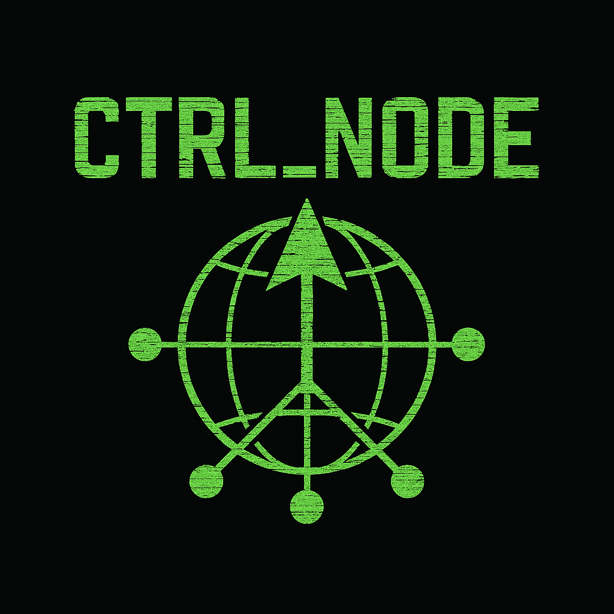

# CTRL_Node

[](https://github.com/NotTheRealWallyx/CTRL_Node/actions/workflows/ci_entrypoint.yml) [](https://www.codefactor.io/repository/github/nottherealwallyx/ctrl_node)



Scan the ports of your server or get the DNS records with this small scripts.

## Features

- **Port Scanning**: Scan all ports or common ports of a remote server.
- **DNS Lookup**: Retrieve DNS records such as MX, NS, A, AAAA, SOA, and TXT.
- **Host to IP Conversion**: Convert a hostname to its corresponding IP address.
- **WHOIS Lookup**: Perform a WHOIS lookup for a given domain.
- **TraceRoute**: Trace the route to a given IP address or hostname.
- **SSL/TLS Certificate Check**: Inspect a remote server's certificate for subject, issuer, and expiry.
- **Website Latency Check**: Break down request latency into DNS lookup, TCP connect, TLS handshake, time to first byte, and content download.

## Installation

Clone the repository from Github with:

```shell
git clone git@github.com:NotTheRealWallyx/CTRL_Node.git
```

Install the dependencies with [Poetry](https://python-poetry.org/):

```shell
poetry install
```

## Requirements

- Python 3.9+
- [Poetry](https://python-poetry.org/) for dependency management

## Usage

Run the application with:

```shell
poetry run ctrl-node
```

If you're working from a source checkout and don't want to use the
installed console script, you can also run it as a module:

```shell
poetry run python -m ctrl_node
```

## Tools used

### Format

To keep the application with a standard we use the following tools:

- [isort](https://timothycrosley.github.io/isort/)
- [Black](https://black.readthedocs.io/en/stable/)

### Versioning

We use [SemVer](http://semver.org/) for versioning.

## Licence

[MIT - Licence](LICENSE)

This program is intended for individuals to test their own equipment for weak security, and the author will take no responsibility if it is put to any other use.
